jogos · bots de Discord · ferramentas web

  

### 🌊 linguagens

### 🍃 foco de estudo

**segurança** (pentest, OSINT, engenharia reversa) · **sistemas e redes** · **backend e bancos de dados** · **arquitetura distribuída** · **frontend em Rust (Leptos/Tauri)**

### 💧 dia a dia

Arch Linux · Vim · Git

 

